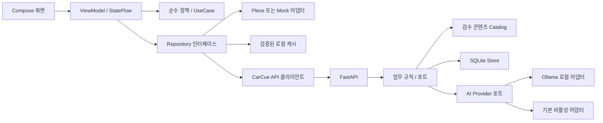

# CarCue 아키텍처 결정

2026-11-14. 현재 구현을 보존하면서 다음 기능부터 적용할 구조다. 제품 요구와 구현 순서는 `DEVELOPMENT_ORDER.md`를 따른다. 예전 `02-mvp-and-architecture.md`는 결정 이력이며 현재 우선순위를 대체하지 않는다.

## 선택한 모델

Android는 **MVVM + 단방향 상태 흐름(UDF)**으로 화면을 구성하고, **Clean Architecture의 의존성 경계**를 점진적으로 적용한다. 서버는 **모듈형 모놀리스 + Ports & Adapters**로 개발한다. 초기에는 Android 단일 Gradle 모듈과 FastAPI 단일 배포를 유지한다.

| 영역 | 기술과 역할 | 의존성 규칙 |
| --- | --- | --- |
| 화면 | Kotlin / Compose | UiState 표시와 사용자 이벤트 전달. SDK·HTTP 직접 호출 금지 |
| 화면 상태 | ViewModel / Coroutines / StateFlow | 상태·로딩·실패·UX 제한 관리. 업무 규칙은 순수 정책/UseCase에 위임 |
| 업무 규칙 | Kotlin 모델·정책·필요한 UseCase | 차량/매뉴얼 일치, 게시 가능 여부, TTL 등. Compose·SDK·HTTP 구현에 의존하지 않음 |
| 데이터 | Repository 인터페이스와 구현 | Pleos/Mock, 서버, 검증된 로컬 캐시를 공통 모델로 변환 |
| 서버 진입 | FastAPI / Pydantic | 요청 검증, 인증, 응답 변환 |
| 서버 업무 | 조회·가이드 게시 정책·답변 출처 검증·세션 정책 | 외부 AI나 저장 방식과 독립된 규칙 |
| 서버 어댑터 | 파일 Catalog, SQLite Store, Ollama/비활성 AI Provider | 포트에 맞춰 데이터/외부 서비스를 제공. 생성 시 의존성 주입 |
| 공통 계약 | `contracts/` JSON Schema, `content/` 카탈로그 | 프로필·언어·매뉴얼 버전·검수 상태를 명시 |



화면 이벤트는 ViewModel로 들어가고, 데이터 결과는 UiState로 돌아와 Compose가 다시 표시한다. SDK callback도 같은 경로로 처리한다. 도어 값의 source, 수신 시각, 오류·미지원·오래된 값, UX 제한을 잃지 않는다. `LIVE` 서버 모드는 차량값의 `PLEOS/MOCK` 출처와 별개다.

## 현재 코드와 점진적 정리

현재 앱에는 이미 ViewModel/StateFlow, VehicleRepository, demo/pleos flavor 어댑터가 있다. 다만 `CarCueViewModel`에 API 생성, JSON 변환, 세션·캐시 조정이 함께 있어 완전한 계층 분리를 마친 상태는 아니다. 기능 변경 시 해당 책임을 작은 단위로 옮긴다. 앱 전체 재작성이나 모든 기능에 형식적인 UseCase 추가는 하지 않는다.

목표 패키지 경계는 아래와 같다. 디렉터리가 모두 이미 존재한다는 의미는 아니다.

```text
android/app/src/main/.../
  app/                   # 의존성 조립, 앱 진입
  feature/               # onboarding, home, status, guide, assistant, session
  domain/                # 공통 모델, 순수 정책, 필요한 UseCase, Repository 포트
  data/                  # vehicle, content, ai, session 구현
  ui/                    # 공통 테마·컴포넌트
android/app/src/{demo,pleos}/  # 빌드별 차량 어댑터
backend/app/
  main.py                # 현재 API/의존성 조립; 커질 때 api/application 분리
  guide_policy.py        # 이번에 분리한 순수 게시 정책
  content.py             # 파일 Catalog 어댑터
  answer_policy.py       # 완전한 검수 단위·출처 검증
  translation_terms.py   # 판본별 질문 용어·누락 검증
  provider.py            # AI 포트·비활성 기본 factory
  local_provider.py      # 네이티브 Ollama 어댑터
  storage.py             # SQLite 세션 저장 어댑터
```

의존성은 생성자/팩토리에서 명시적으로 주입한다. 현재 규모에서는 별도 DI 프레임워크, 멀티모듈 전환, 마이크로서비스를 추가하지 않는다. 기능 간 결합이나 빌드·배포 요구가 실제로 커질 때 별도 결정으로 분리한다.

## 이번 단계에 적용하는 경계

1. 서버의 `validate_guide()`는 부작용 없이 구조·프로필·언어·매뉴얼·출처·번역·단계를 검사한다. 등록 CLI와 실제 조회 Catalog가 같은 규칙을 사용한다.
2. CLI는 입력과 파일 저장을 맡는다. 검수 상태를 승격하거나 매뉴얼을 생성하지 않는다. 가이드 식별자·언어·매뉴얼 세트·원문 버전의 조합을 불변 레코드로 등록한다.
3. Android는 서버 JSON과 캐시를 화면 모델로 바꾸기 전에 게시 메타데이터를 다시 검사한다. 서버가 성공적으로 빈 목록을 반환하면 예전 캐시를 비운다. 다른 차량·버전·언어의 안내로 대체하지 않는다.
4. API 키와 AI 호출은 서버에만 둔다. 검수 자료와 출처 검증을 통과한 결과만 앱으로 전달하며 실제 호출 여부를 따로 기록한다.

## 검증과 다음 구현 순서

- 순수 정책: JVM/Python 단위 테스트로 프로필·버전 불일치, 미검수 번역, 출처/단계 오류, 캐시 철회를 검증한다.
- 서버 경계: HTTP API 테스트로 게시 불가 문서가 목록·상세에 나오지 않는지 확인한다. CLI는 임시 카탈로그에서 원자적 등록·중복·충돌·실패 시 보존을 검증한다.
- 앱 경계: 변경한 flavor를 빌드하고 단위 테스트를 실행한다. SDK 수신/리스너/UX 변경 시에는 전용 AVD에서 실제 GET·callback·화면·해제까지 다시 확인한다.
- 실제 외부 연결: 합성 자료나 AI HTTP 대역 테스트를 실제 매뉴얼 검수·실차·실제 AI 호출의 증거로 쓰지 않는다.

개발 순서는 **검수 가이드 등록·검증 → 실제 차종/매뉴얼 자료 검수 및 상태별 안내 규칙 연결 → 검수 자료 기반 AI·번역 실제 호출 → 언어·UX·종료 회귀 → 시연 갱신**이다. 공식 자료나 실제 호출 증거가 없는 단계는 완료로 올리지 않고, 독립적인 구현과 테스트를 계속한다. 각 작업은 `feature/`에서 검증·커밋 후 develop에 통합한다.

## 무료 로컬 AI 단계

유료 OpenAI 연결은 사용자 요청으로 보류했다. 기존 어댑터를 보존하고 기본 factory는 DISABLED 또는 OLLAMA_LOCAL만 허용한다. 모델은 Mac 서버에서 실행하며 APK에는 포함하지 않는다. ask는 검수 단위 ID 선택, ANSWER/GUIDE 번역은 동일 판본의 저장 번역, 자유 QUESTION 생성 번역은 실제 의미 오류 확인 후 기본 보류했고, 명시적 개발 옵션에서만 UNREVIEWED로 시험한다. 완전한 주의문·출처·프로필 검증을 통과해야 한다. 질문 용어 보존 검사도 전체 의미 정확성을 보증하지 않는다. 실제 호출과 제한은 `LOCAL_AI_INTEGRATION.md`에 기록한다.

앱은 MVVM/UDF를 유지하고 `AssistantRequestPolicy`로 전송 재시도와 새 요청을 구분한다. 네트워크 재전송은 동일 request_id와 직렬화 본문을 보존한다. 서버의 일시 불가 결과에 대한 사용자 재시도는 새 요청이며, 세션 만료·동의 철회·UX 제한·종료 시에는 기존 취소·삭제 정책을 적용한다.

## 오프라인 가이드와 삭제 복구

동봉 자료·파일 캐시·서버 결과는 같은 게시 정책을 통과하며 GuideOrigin BUNDLED/CACHE/SERVER로 표시한다. guideConnection은 차량 SDK·AI 요청 상태와 분리한다. 캐시의 null은 미존재이고 빈/손상 스냅샷은 알려진 차단 상태다. 서버의 빈 응답도 원자적으로 저장해 앱 재실행이 동봉 자료로 철회를 되돌리지 않게 한다. v1의 삭제형 빈 캐시를 처음 설치로 오인하지 않도록 설치 시각과 영속 bootstrap 결정을 사용한다. 기존 갱신 설치에 결정이 없으면 동봉 fallback을 차단하고 서버 동기화/기존 유효 캐시를 사용한다.

화면의 Guide 객체는 실행 시 현재 목록에서 다시 찾는다. 같은 profile/manual/locale의 철회는 열린 가이드와 질문의 복귀 대상에도 반영하고, UI 언어만 바뀐 다른 원문은 임의로 철회하지 않는다.

삭제 작업은 앱 프로세스 범위의 SessionDeletionRecovery에서 수행한다. 순수 SessionDeletionStore 포트와 단일 coordinator가 중복 trigger를 합치며 기본 최대3회(1초·3초 대기)로 제한한다. request/VM 취소와 독립이고, 늦은 세션 생성·연결 복구·foreground·이용 종료·수동 확인이 같은 처리기를 사용한다. 최소 삭제 자격 정보만 SharedPreferences에 남기며 본문·번역·차량값은 저장하지 않는다. HTTP200의 명시 DELETED 또는 정확한 세션 무효/만료401 확인 후에만 큐에서 제거한다. 프로세스 재시작 복구는 별도 실제 기기 검증으로 판단한다.


## 공식 외부 자원과 UX 연결 소유권

MVVM/UDF를 유지한다. ContentRepository는 동봉 공식등록과 게시메타데이터를 보존하고, 순수 OfficialResourcePolicy가 현재세션epoch/프로필/판본/출처/UX에서 실행대상을 다시해석한다. ViewModel은 typedcitation과 answerRequestId를 보존하며 Android전달은 OfficialResourceOpener 하나로 모은다. 모델URL은 실행하지 않는다. SDKdebug Browser2호환은 platform adapter 안에 한정한다.

UXConnectionGate는Android밖에서 연결별소유권/실패예산만 관리한다. 실제 Car/manager/listener/Handler는 PlatformUxMonitor가 attempt별로 소유하고 fresh UX GET 전에는unknown을 유지한다. callback/stop/timer 순서와 실제 Car값은 분리한다. 이 변경을 위해 새프레임워크나 Gradle멀티모듈을 도입하지 않았다. `UX_CONNECTION_RECOVERY.md`와 `OFFICIAL_RESOURCE_APP_VALIDATION.md` 참조.

## 다국어 응답과 실행 경계 · 2026-11-15

MVVM/UDF와 기존 Repository/서버 Ports & Adapters를 유지한다. 순수 `AssistantBoundaryPolicy`는 epoch·프로필·UI언어·화면·번역 종류/원문과 현재 UX/활성 여부를 실행·응답 시점에 재검사한다. 화면에서 캡처한 scope를 새 세션에서 실행 권한으로 재사용하지 않는다. Compose의 동의 상태는 입력/맥락 변경에 맞춰 초기화하고, 취소·언어 변경·화면 이동·종료는 기존 operation/coroutine 경계와 함께 적용한다.

답변 `answerLocale`, 번역 원문 언어, 요청 대상 UI언어와 완료 `translationTargetLocale`를 분리한다. 이전 답변은 원문 언어와 함께 보존하고 대상 변경 때 과거 번역 결과만 비워 새 번역으로 오표시하지 않는다. 질문 복귀와 번역 복귀 경로를 분리하며, 가이드 철회 시 기존 GuideSelectionPolicy를 통해 유효한 목적지만 남긴다. 서버의 생성 질문 번역 보류는 새 호출과 과거 캐시에 동일하게 적용한다. `MULTILINGUAL_ASSISTANT_BOUNDARIES.md`, `QUESTION_DEFERRAL_CACHE.md`, `SDK_SESSION_VALIDATION.md` 참조.
