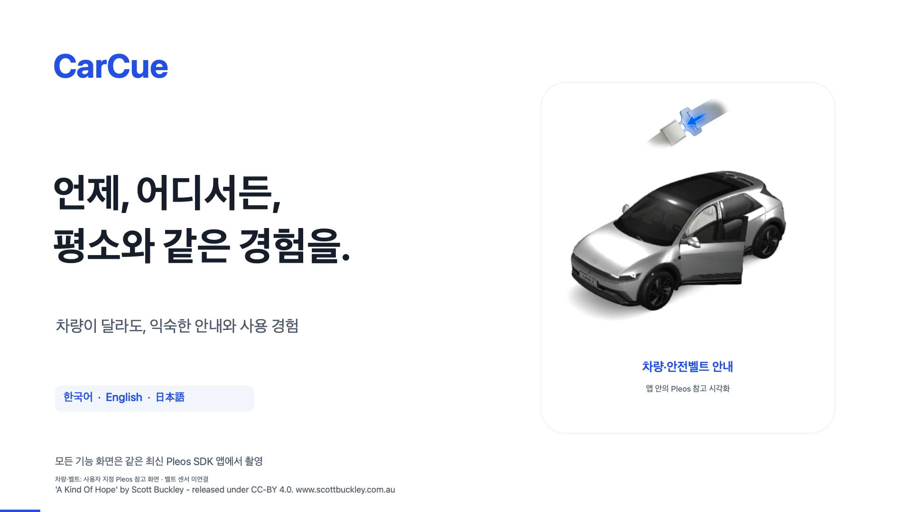

# CarCue(카큐)

> 언제, 어디서든, 평소와 같은 경험을.

낯선 차량의 상태와 사용법을 한국어·영어·일본어로 확인하는 Pleos 차량 앱입니다.

**현재 개발은 develop 브랜치에서 진행 중입니다. 최신 코드와 실행·개발 문서는 develop 브랜치에서 확인해 주세요.**

**[develop 브랜치에서 최신 코드와 실행 방법 보기 →](https://github.com/calmkeen/Hyundai_appdevchallenge2026/tree/develop#readme)**

이 main 브랜치는 프로젝트 소개와 개발 경로를 안내합니다.

## 34초 소개 영상

**[영상 보기](https://github.com/calmkeen/Hyundai_appdevchallenge2026/blob/develop/media/intro/carcue-sdk-intro.mp4) · [MP4 다운로드](https://github.com/calmkeen/Hyundai_appdevchallenge2026/raw/refs/heads/develop/media/intro/carcue-sdk-intro.mp4)**

한국어·영어·일본어 안내를 담은 34초 편집본입니다. 동일한 앱의 연속 녹화에서 전용 AVD의 실제 Pleos SDK 연결, 문 상태 변화, 공식 안내, 무료 로컬 AI 선택과 저장 번역을 보여줍니다.

영상은 이전 debug APK의 검증 기록입니다. 새 제출 후보 **0.1.1-rc1 Release APK**의 기기 실행 증거와 구분하며, 실차 시험 영상은 아닙니다. 차량 그림은 앱 내부 참고 시각화이고 안전벨트 센서는 미연결입니다.

음악: 'A Kind Of Hope' by Scott Buckley - released under CC-BY 4.0. www.scottbuckley.com.au

[곡 출처](https://www.scottbuckley.com.au/library/a-kind-of-hope/) · [CC BY 4.0](https://creativecommons.org/licenses/by/4.0/) · [영상 전체 크레딧](https://github.com/calmkeen/Hyundai_appdevchallenge2026/blob/develop/media/intro/CREDITS.txt)

## 최신 코드와 문서

- [develop README — 실행 환경·설치·소스 빌드](https://github.com/calmkeen/Hyundai_appdevchallenge2026/tree/develop#readme)
- [전체 실행·개발 안내](https://github.com/calmkeen/Hyundai_appdevchallenge2026/blob/develop/Docs/RUNBOOK.md)
- [아키텍처](https://github.com/calmkeen/Hyundai_appdevchallenge2026/blob/develop/Docs/ARCHITECTURE.md) · [API 계약](https://github.com/calmkeen/Hyundai_appdevchallenge2026/blob/develop/Docs/DATA_API_SPEC.md)
- [소개 영상의 촬영·편집·검증 범위](https://github.com/calmkeen/Hyundai_appdevchallenge2026/blob/develop/Docs/SDK_LIVE_INTRO.md)
- [제출 후보 APK와 검증 범위](https://github.com/calmkeen/Hyundai_appdevchallenge2026/blob/develop/Docs/SUBMISSION_RELEASE_APK.md) · [제출 준비 현황](https://github.com/calmkeen/Hyundai_appdevchallenge2026/blob/develop/Docs/SUBMISSION_READINESS.md)

## 고정 제출 후보

현재 개발과 별도로, **0.1.1-rc1 제출 후보 스냅샷**은 [커밋 31cdf2d](https://github.com/calmkeen/Hyundai_appdevchallenge2026/tree/31cdf2d)에서 확인할 수 있습니다.

최신 개발 내용은 위 develop 링크를 기준으로 확인해 주세요.
